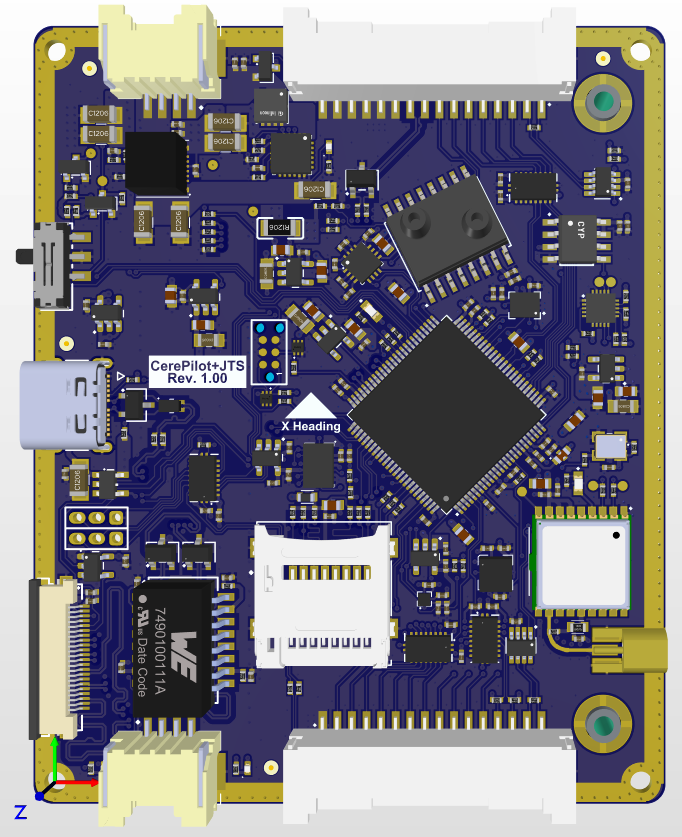
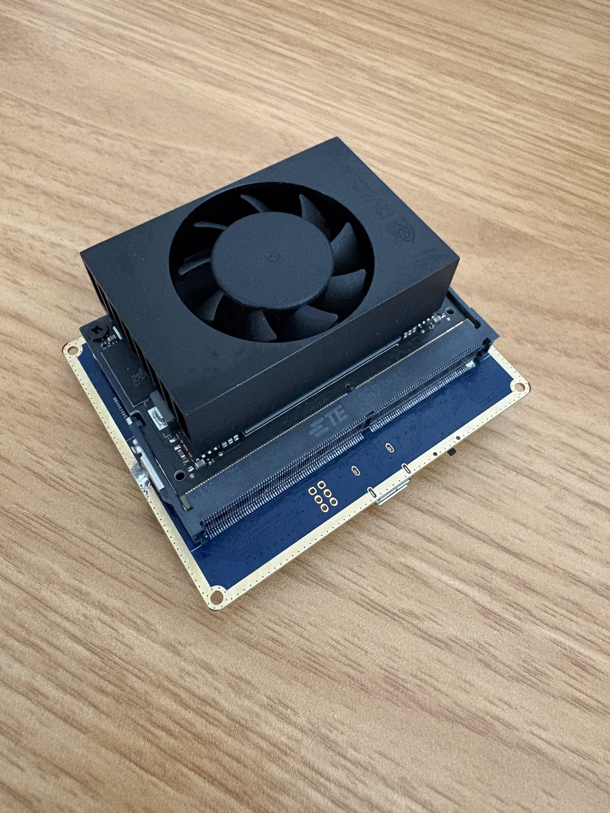
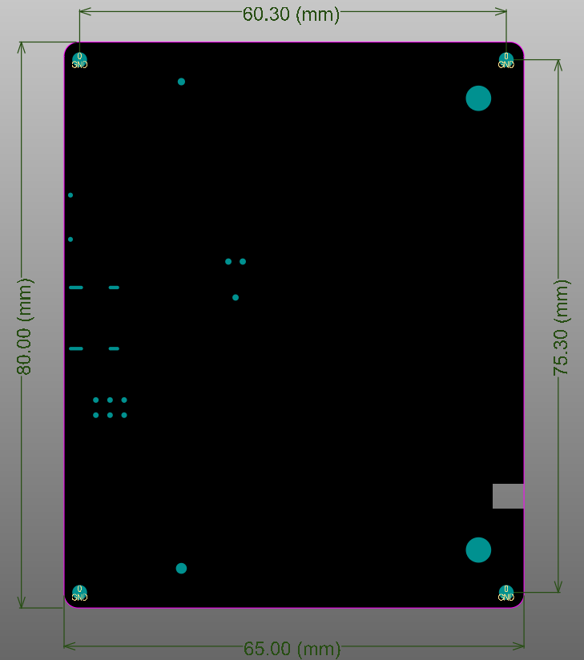

# CerePilot V1.00 – Hardware Overview

## Photos

| Top | Bottom, with Jetson module and cooler |
|:---:|:---:|
|  |  |

The Jetson module sits in connector J1100 on the bottom side, so the
cooler adds to the stack height on that side.

## Mechanical

| Parameter | Value |
|---|---|
| PCB size | 80.00 × 65.00 mm |
| Mounting hole pattern | 75.30 × 60.30 mm |
| Mounting hole diameter | 2 mm |
| Weight | 55 g |

The four corner mounting holes are tied to GND. The **X Heading** arrow
printed on the silkscreen marks the vehicle's forward direction.

## Connectors

| Connector | Function | Board connector | Mating connector |
|---|---|---|---|
| Input Power | 4-pin power input | JST SM04B-ZESS-TB | JST ZER-04V-S |
| Ethernet | 10/100BASE-TX | JST SM04B-ZESS-TB | JST ZER-04V-S |
| User Interface_1 | FMU I/O | JST SM16B-ZESS-TB | JST ZER-16V-S |
| User Interface_2 | FMU I/O | JST SM16B-ZESS-TB | JST ZER-16V-S |
| USB HS | Jetson USB-C | — | — |
| Camera CSI | Jetson camera | 54548-2272 | — |
| GPS MMCX Antenna | GNSS antenna | MMCX | — |
| Jetson Off/ON | Jetson power switch | — | — |

Connector positions are shown on the
[user pinout drawing](../drawings/CerePilot_V1.00_User_Pinout.pdf), and pin
assignments are in [pinout.md](pinout.md).

## Power Input

| Parameter | Value |
|---|---|
| Input voltage range | 6.5 V – 26 V (2S – 6S LiPo) |
| Protections | Reverse polarity, over/under voltage, over current, short circuit, power surge |
| Soft start | Yes |
| Connector | JST SM04B-ZESS-TB (mating: JST ZER-04V-S) |

The board has no analog battery voltage or current sensing. For battery
monitoring, connect an I²C power module to the external I²C port. See
[ardupilot.md](ardupilot.md#battery-monitoring).

## Flight Management Unit

| Function | Part | Interface |
|---|---|---|
| MCU | STM32H753VIT6 | — |
| Clock | ECS-TXO-3225MV-160 16 MHz TCXO | HSE input |
| IMU 1 | BMI088 | SPI3 |
| IMU 2 | ISM330DLC | SPI4 |
| Magnetometer | BMM350 | I²C (internal) |
| Barometer | BMP585 | I²C (internal) |
| Differential pressure | SM9541-100C-D (−100 to +100 cmH₂O) | I²C (internal) |
| GNSS | u-blox MAX-M10N, MMCX antenna | UART4 |
| Parameter storage | FM25V02A 32 KB FRAM | SPI1 |
| Logging | microSD | SDMMC1, 4-bit |
| Status LEDs | Green and blue | GPIO |
| Debug | SWD header (J100) | SWD |

The FMU schematic page is published as
[`schematics/CerePilot_V1.00_FMU_schematic.pdf`](../schematics/CerePilot_V1.00_FMU_schematic.pdf).

### Sensor power

The sensors run from separate switched rails (3.3 V sensors, 1.8 V sensors
and a dedicated 3.3 V BMI088 rail). The FMU controls each rail. It also
measures each rail through a 10 kΩ / 10 kΩ divider, together with the 5 V
input and the main 3.3 V rail.

### FMU interfaces on the user connectors

| Interface | Connector | Notes |
|---|---|---|
| CAN1 (FD) | User Interface_2 | 120 Ω termination on board |
| CAN2 (FD) | User Interface_1 | 120 Ω termination on board |
| SBUS / RC input | User Interface_1 | |
| TELEM1 UART | User Interface_1 | 3.3 V logic |
| RS-232 UART | User Interface_1 | RS-232 levels |
| USB | User Interface_1 | |
| PWM/AUX 1–9 | User Interface_2 | Buffered and protected |
| External I²C | User Interface_2 | |
| Jetson UART | User Interface_2 | Shared with the on-board Jetson |

Both CAN ports are terminated on the board, so the CerePilot is always one
end of the bus.

## Companion Computer

The board carries an NVIDIA Jetson Orin Nano module on connector J1100 on
the bottom side.

| Interface | Details |
|---|---|
| FMU link | Jetson UART1 ↔ FMU UART8 (ArduPilot SERIAL2), 22 Ω series resistors |
| Ethernet | 10/100BASE-TX through WE-LAN 7490100111A magnetics, with ESD protection and link/activity LEDs |
| USB-C | USB 2.0 HS host, common-mode choke, ESD protection, TPS2069 VBUS switch |
| Camera | 22-pin CSI connector (54548-2272), with camera I²C, MCLK and power-down |
| Power switch | Jetson Off/ON slide switch |

The FMU can also control the Jetson's power enable and reset lines, and it
reads the Jetson's shutdown request line.

## Connector Schematics

| Image | Contents |
|---|---|
| [user-interfaces.png](../schematics/connectors/user-interfaces.png) | User Interface_1 and User Interface_2 |
| [usb-c.png](../schematics/connectors/usb-c.png) | USB-C connector, ESD, VBUS switch and routing rules |
| [ethernet.png](../schematics/connectors/ethernet.png) | Ethernet magnetics, ESD, LEDs and connector |
| [camera-csi.png](../schematics/connectors/camera-csi.png) | Camera CSI connector |

For connector pinouts, see [pinout.md](pinout.md).
